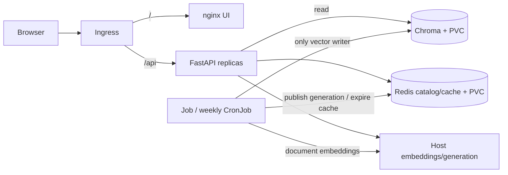

# RAHBAR — Partner Handoff and Completion Guide

> Historical 7 November handoff. GitHub/CI/CD setup notes below are superseded by
> [current submission status](docs/SUBMISSION.md) and [final delivery instructions](docs/FINAL-SUBMISSION.md).

**Prepared:** 7 November 2026  
**Repository:** https://github.com/MuhammadSaimHassan/rahbar  
**Deadline stated in the assignment:** 8 November 2026, 23:59 PKT

## Contents

1. [Read this first](#1-read-this-first)
2. [What has been built](#2-what-has-been-built)
3. [Completed work by phase](#3-completed-work-by-phase)
4. [Verified results and limitations](#4-verified-results-and-their-limitations)
5. [Preserve and publish the work](#5-preserve-and-publish-the-complete-work)
6. [Run locally](#6-run-locally-and-review-the-implementation)
7. [Finish CI/CD](#7-finish-github-and-docker-hub-cicd)
8. [Fresh real deployment and evaluation](#8-fresh-real-corpus-deployment-and-revised-prompt-evaluation)
9. [Remaining demonstrations](#9-remaining-deployment-demonstrations)
10. [Final review and submission](#10-final-review-audit-and-submission)
11. [Troubleshooting](#11-troubleshooting-map)
12. [References](#12-reference-documents)

## 1. Read this first

The application code, containers, Kubernetes definitions, evaluation tools, workflows,
operational tools and written documentation have been implemented. The remaining work
is account/repository setup, deployment verification, evidence collection, team review
and submission. Verification can still expose defects requiring focused fixes;
“coding complete” does not mean all acceptance conditions have passed.

Keep these three environments distinct:

| Environment | What it does | Status |
| --- | --- | --- |
| VS Code preview | UI/API using fixed sample passages and a deterministic stub answer | Dependencies installed; UI, health and sample ask checked |
| Historical real-corpus benchmark | Nomic retrieval and Llama generation over university documents | Phase 5 results saved, with quality/CPU-run limitations |
| Fixture CI/CD | Real indexer/API/Chroma/Redis; fictional documents and a deterministic model substitute | Local checks passed; hosted release/account setup pending |

A preview success does not prove real retrieval. A green fixture gate does not prove
Llama's factual accuracy. Do not replace real benchmark numbers with fixture results.

**Critical transfer detail:** many completed files are modified or untracked. The
checkout was on local `main` with three commits at handoff. Most implementation files
are not committed. Cloning the remote alone may miss the completed work. First publish
the working tree correctly as described below, or transfer a complete source copy
securely while preserving Git history. Do not copy credentials or virtual environments.

### Recommended order

1. Obtain and review the complete working tree.
2. Review/stage/scan it, authenticate GitHub and publish a working branch.
3. Configure Docker Hub, Actions secrets/variable and main protection.
4. Demonstrate the blocked/restored gate and obtain an independent partner review.
5. Merge by PR; verify CD and all three SHA-tagged images.
6. Deploy from a fresh checkout, rerun the revised real-model prompt and review answers.
7. Capture remaining operational/security/persistence/memory evidence.
8. Review documentation, scan/audit again, merge final evidence and submit actual links.

Account setup and local deployment can be split between partners. Restore deliberate
failure settings before a final merge.

## 2. What has been built



- **Indexer:** PDF/HTML/Markdown extraction, OCR, cleaning, page/section-aware chunking,
  embedding and publication of a complete index.
- **API:** input validation, index resolution, query embedding, retrieval, edition and
  relevance filtering, shared answer cache, generation and citation/schema validation.
- **Chroma:** vector/text/metadata storage, single StatefulSet with PVC.
- **Redis:** persistent active-index pointer, writer lease and expiring answer cache.
- **Ollama:** host-side `nomic-embed-text` and `llama3.2:3b`.
- **Kubernetes:** lifecycle, probes, Services, Ingress, PVCs, policies and CPU HPA.
- **CI/CD:** code/image/manifest checks and gated deterministic fixture deployment.

Only the indexer writes vectors. API startup never indexes. The writer stages an
immutable collection and switches the Redis catalog after validation. Readers keep
one generation for the request; cache keys also isolate that generation.

| Configuration | Selected value |
| --- | --- |
| Chunk size / overlap | 400 / up to 50 lexical tokens |
| Embedding / dimension | nomic-embed-text / 768 in real mode |
| Generation / temperature | llama3.2:3b / 0.2 |
| Top-k / relevance floor | 5 / 0.70 |
| Cache threshold | 0.85 plus edition/evidence/numeric/polarity guards |
| API replicas / HPA | Three initially; min 3, max 8, CPU target 70% |
| Indexer memory | 256 MiB request, 1 GiB limit; production container peak pending |
| API shutdown | 15-second preStop, 330-second termination grace |

Base/dev configuration defaults to stubs. `k8s/overlays/real-query` activates real
retrieval/generation. `k8s/overlays/ci` activates fictional fixture behavior.

## 3. Completed work by phase

| Phase | Completed implementation | Remaining acceptance work |
| --- | --- | --- |
| 0: setup | Ubuntu WSL2, Python/Git/Docker access, local repository, corpus choice | Shared remote, collaborator access, protected main/dev process |
| 1: Kubernetes | Non-root images; requests/limits; probes, storage, accounts, policies, Services, Ingress, HPA and overlays | Calico denial and persistence evidence on documented minikube deployment |
| 2: corpus/indexing | Nine public sources, seven PDFs totaling 279 pages; hash verification, OCR/tables, cleaning/chunking, embedding/publication | Fresh deployment and production whole-container memory measurement |
| 3: golden set | 20 source-authored questions, 12 cache pairs, projection/lock committed before tuning | Team source/oracle review; preserve ordering |
| 4: query | Real retrieval, Ollama, optional hosted generation, edition/follow-up/cache logic, validation, retry/fallback and metrics | Fresh real-model run after prompt change; live hosted test only if used |
| 5: evaluation | Three chunk configurations, three cache cutoffs, historical results/baseline and manual review | Evaluate current revised prompt |
| 6: CI/CD | Workflows/scripts, local fixture green/red/green gate, scans | Hosted runs, branch protection, PR screenshots, Docker Hub SHA images |
| 7: demonstrations | Fixture rollout/rollback/Pod replacement and four measured failure comparisons/write-ups | Remaining real deployment proofs, memory peak and personal incident review |
| 8: documentation | README, architecture, corpus/pipeline/failure docs, four ADRs, seven answers, AI disclosure, evidence index/checklist | Team review, clean-clone acceptance, final publication/audit/submission |

### Implementation details already handled

- Questions are trimmed and restricted to 3–500 characters.
- Current queries exclude superseded documents; supported historical intent selects an edition.
- Readiness checks Redis, catalog, Chroma, nonempty collection and embedding metadata.
- Liveness does not depend on databases or models.
- Citations must match retrieved source/section/page; invalid generation retries once,
  then returns a safe fallback. Internal reasoning is removed from public responses.
- Follow-ups, abstentions, failed/retried validations and fallbacks are not shared cached answers.
- Cache keys isolate generation, evidence, edition, endpoint/provider/model and prompt settings.
- Hosted generation supports configured HTTPS strict-schema-compatible endpoints;
  HTTP mocks passed, but no live hosted account was tested.
- Logs/metrics provide request IDs, evidence IDs/scores, latency, cache outcomes,
  abstentions/fallbacks and token accounting.
- Containers use runtime allowlists, non-root users, read-only roots, dropped
  capabilities and writable temporary mounts.
- The VS Code Makefile bug with `Assignment 2` was corrected: venv executable paths
  are quoted, and package installation invokes `python -m pip`.

### Main files

| Path | Purpose |
| --- | --- |
| `api/app/` | Routes, settings, retrieval, providers, cache and validation |
| `indexer/pipeline/` | Extract → clean → chunk → embed → store |
| `ui/index.html` | Browser chat |
| `k8s/base/`, `k8s/overlays/` | Kubernetes objects and modes |
| `corpus/sources.yaml`, `corpus/MANIFEST.md`, `corpus/fetch.py` | URLs, versions, hashes and downloads |
| `eval/golden.yaml`, `eval/golden.lock.json`, `eval/relevance.current.json` | Frozen oracle and chunk projection |
| `eval/run_eval.py`, `eval/sweep.py` | Evaluation gate and tuning |
| `eval/failure_experiments.py` | Four read-only failure comparisons |
| `scripts/operational_demo.py` | Rollout/rollback/endpoints/Pod replacement/restoration |
| `.github/workflows/ci.yml`, `.github/workflows/cd.yml` | Hosted check/publish/deploy workflows |
| `docs/evidence/README.md`, `docs/SUBMISSION.md` | Evidence map and outstanding deliverables |

## 4. Verified results and their limitations

These are saved observations, not newly rerun measurements at handoff time.

### Coding and preview

- Final coding verification: **87 tests passed**, one integration skip; API coverage **82.80%**.
- Ruff/type checks passed in the saved coding run.
- Seven fixture questions passed through Ingress, including historical edition
  isolation and a poisoned retrieved passage.
- Latest WSL preview setup: dependency installation and `pip check` passed; TestClient
  returned 200 for UI, health and sample ask. Uvicorn 0.34.2 was imported successfully.
- That check left no server running; the owner may separately have started one.

See `docs/evidence/coding-validation.txt` and `docs/evidence/vscode-startup-validation.txt`.

### Historical real-corpus quality

| Metric | Recorded result |
| --- | --- |
| Recall@3 / recall@5 | 77.8% / 88.9% |
| Emitted citation validity | 100%, over ten citations |
| Required abstentions | Both correct |
| Answerable questions | 18 |
| Grounded responses / safe fallbacks | Seven / eleven |
| Manual review of seven responses | Five fully correct, one incomplete, one incorrect |

The incorrect answer reversed passed/failed lab and theory components. Attendance
omitted the F/A grade. Version-sensitive recall@5 was lowest at 75%; exact-term
recall@5 happened to be 100% over three questions.

The CPU run used precomputed pinned Nomic vectors for the exact benchmark questions,
live Chroma ranking, Llama generation and some validated cached answers from an earlier
attempt. It is not an unrestricted cold end-to-end latency benchmark. Model IDs,
context/timeout settings and adapter caveats are recorded in [PIPELINE.md](docs/PIPELINE.md).

**The prompt changed afterward; its real-model improvement has not been verified.**
Preserve `eval/results.json` and `eval/baseline.json` until the replacement run is reviewed.

### Tuning and failures

| Comparison | Recorded result |
| --- | --- |
| 300/30 | 1,037 chunks; recall@3 77.8%, recall@5 88.9% |
| 400/50 | 950 chunks; recall@3 77.8%, recall@5 88.9%; selected |
| 550/75 | 902 chunks; recall@3 72.2%, recall@5 88.9% |
| Cache 0.85 / 0.90 / 0.95 with guards | Zero false hits at each; one of six equivalent paraphrases reused |
| OCR disabled on scanned policy | 2,264 normal tokens → zero |
| Fixed 100 tokens / no overlap | Evidence mapping 18/18 → 17/18; this is not ranked recall |
| Wrong embedding pin | Five hits → rejection → five after restoration |
| Superseded filter removed | Zero retired hits → three among ten fixture hits |

### Operations and release

- Before the drain fix: one 502 in 174 requests. Final fixture run: **135 successful
  samples, zero failures**, three ready endpoints, rollout/rollback/Pod replacement restored.
- Resource/HPA output was saved. HPA bounds were temporarily fixed at three by the
  tool; this does not demonstrate automatic scale-out or real-model throughput.
- A synthetic-vector re-index smoke test recorded 37 successful readiness samples;
  this does not establish production-model re-index continuity.
- Local fixture gate failed at floor 1.01 and passed after restoring 0.70.
- Recorded Trivy scans found zero fixable HIGH/CRITICAL findings in three patched
  images. Rerun scans because vulnerability data changes.
- Hosted CD, published SHA tags and GitHub protection/merge screenshots are pending.

## 5. Preserve and publish the complete work

Do this first on the current checkout. Do not reset/discard files, remove `.git`,
force-push or replace this directory with the original starter.

### 5.1 Inspect history and pending files

```bash
cd "/mnt/e/course/SEM-5-Course/SCD/Assignment 2/rahbar-starter"
git status --short
git branch -vv
git log --oneline --all --decorate -8
git remote -v
```

| Existing commit | Purpose |
| --- | --- |
| `12281e6` | Original starter kit |
| `cccf3d1` | Freeze source-authored golden set before tuning |
| `2e5512d` | Real evaluation and tuning baseline |

Keep their ordering and real authorship. Do not manufacture contributions or history.

### 5.2 Authentication and identity

Replace these placeholders with the actual author's details:

```bash
git config user.name "YOUR FULL NAME"
git config user.email "YOUR VERIFIED OR GITHUB NOREPLY EMAIL"
```

The GitHub login is the account handle, not a display name with spaces. GitHub and
Docker credentials are distinct; neither is the Ubuntu sudo password.

Use existing secure Git authentication if configured. With GitHub CLI installed:

```bash
gh auth login --hostname github.com --git-protocol https --web
gh auth setup-git
gh auth status
```

See the official [GitHub CLI login guide](https://cli.github.com/manual/gh_auth_login).
If `gh` is absent, install it following the official CLI instructions or configure
supported HTTPS credential storage/SSH. Never embed a token in the remote URL.

### 5.3 Working branch, review and commit

The assignment explicitly requires dev. If it does not exist:

```bash
git switch -c dev
```

If dev already exists, inspect it before switching; do not overwrite it. Move current
uncommitted work onto a working branch before committing new implementation changes.

```bash
git check-ignore corpus/raw/ .venv/
git diff --stat
git ls-files --others --exclude-standard
git diff
```

Read new files too: `git diff` alone omits their contents. Keep source/docs/workflows,
manifest, golden files and safe evidence. Exclude downloaded PDFs/HTML, `.env`, real
Secrets, tokens, kubeconfigs, `.venv`, raw OCR and model artifacts.

```bash
git add -A
git diff --cached --stat
git diff --cached --check
git diff --cached
```

Run section 10's secret checks before publishing. Once reviewed:

```bash
git commit -m "feat: complete RAHBAR implementation and handoff"
git remote set-url origin https://github.com/MuhammadSaimHassan/rahbar.git
git ls-remote --heads origin
```

If remote main exists, fetch/check related history and push dev, then open a PR:

```bash
git fetch origin
git push -u origin dev
```

If histories are unrelated, reconcile with the owner; do not force-push.

If the remote is completely empty, an owner must establish a baseline main before
a PR can target it. One-time initialization can publish only the original starter
commit as main, then dev:

```bash
git push origin 12281e6:refs/heads/main
git push -u origin dev
```

Use that bootstrap only after confirming remote main is absent. It is not permission
for later direct main pushes. Document it honestly; if the course's no-direct-main
rule includes initial branch creation, confirm the permitted initialization procedure
with the instructor. Completed implementation/evidence should reach main by reviewed PR.

### 5.4 Partner access and transfer

The owner should add the partner as a collaborator; the partner must accept. Each
partner should author real contributions and review the other's PRs. A PR author
cannot provide their own independent approval.

Once the completed branch is actually published, the partner can clone it:

```bash
git clone --branch dev https://github.com/MuhammadSaimHassan/rahbar.git
cd rahbar
```

## 6. Run locally and review the implementation

Commands below are Bash in Ubuntu/WSL, from the repository root unless stated otherwise.
Only `wsl -d Ubuntu-24.04` is a PowerShell entry command. Adjust the checkout location
on another machine; a source checkout inside `~/projects/` can reduce Windows-mount I/O.

### 6.1 Install dependencies and launch the preview

Original machine: Ubuntu lives on F, source on E, and the installed environment is
`/home/saim_hassan12345/.venvs/rahbar`. Reuse it there. On a new machine:

```bash
sudo apt update
sudo apt install -y python3-venv python3-pip make
make install VENV="$HOME/.venvs/rahbar"
source "$HOME/.venvs/rahbar/bin/activate"
python -m pip check
```

Installation is quiet while pip downloads and can take time. Do not copy/commit the
machine-specific venv. Launch:

```bash
cd api
SERVE_UI_DIR=../ui RETRIEVER=stub LLM_PROVIDER=stub python -m uvicorn app.main:app --reload --port 8001
```

Open http://localhost:8001 or http://localhost:8001/docs. Ask “What CGPA avoids academic
warning?” Expect `(stub)` and a `stub-handbook.pdf` citation. Another question returns
the same evidence; this is wiring verification, not real university answering.

In a second Ubuntu terminal:

```bash
curl -s http://localhost:8001/healthz
curl -i http://localhost:8001/api/ask -H 'Content-Type: application/json' -d '{"question":"hi"}'
```

Expect `{"status":"alive"}` and HTTP 422 for the short question. Readiness can be 503
without databases/index. Stop the preview with Ctrl+C before changing modes.

### 6.2 Offline checks

From the root:

```bash
source "$HOME/.venvs/rahbar/bin/activate"
make test VENV="$HOME/.venvs/rahbar"
make lint VENV="$HOME/.venvs/rahbar"
make golden-check VENV="$HOME/.venvs/rahbar"
(cd api && python -m pytest --cov=app --cov-report=term-missing --cov-fail-under=60)
```

Pass `VENV="$HOME/.venvs/rahbar"` to targets using this environment. Activation alone
does not change Makefile's `.venv` default. `make dev` uses port 8000; the explicit
preview command uses 8001, avoiding another application's occupied port.

## 7. Finish GitHub and Docker Hub CI/CD

### 7.1 Docker Hub repositories and token

1. Open [Docker Hub](https://hub.docker.com/) in a browser and sign in.
2. Identify the account/organization namespace. This is not a display name or email.
3. Create `rahbar-api`, `rahbar-ui` and `rahbar-indexer` under that namespace. Public
   repositories make instructor access and external pulls simpler.
4. Create a Docker personal access token with the read/write permission needed to push,
   a recognizable description and an appropriate expiry.
5. Store it securely and enter it directly into GitHub's secret form. Do not put it in
   chat, files, screenshots or shell command arguments.

Docker's [access-token guide](https://docs.docker.com/security/access-tokens/) explains
CLI/automation token authentication. Use the token setup already wired into this workflow.

### 7.2 Actions secrets and variable

Open repository **Settings → Secrets and variables → Actions**. Use the Secrets and
Variables tabs to add these exact names:

| Type | Name | Value |
| --- | --- | --- |
| Repository variable | `DOCKERHUB_NAMESPACE` | Owner of the three image repositories |
| Repository secret | `DOCKERHUB_USERNAME` | Docker account permitted to push there |
| Repository secret | `DOCKERHUB_TOKEN` | Its Docker access token |

Namespace and login may differ for an organization. The deterministic fixture needs
no real model API key. Follow GitHub's [repository secret instructions](https://docs.github.com/en/actions/how-tos/write-workflows/choose-what-workflows-do/use-secrets).

### 7.3 First CI run and main protection

Push dev and open **Pull requests → New pull request**, base main, compare dev.
Expected jobs: `lint`, `test`, `manifests`, `build`, `scan`, `e2e-eval`.
Read the actual first failing job log; do not disable checks to make the badge green.
A new vulnerability finding requires a real dependency/base fix and another scan.

Configure main's branch protection rule/ruleset to require PRs, one independent approval
and all six checks. Select the actual check names after GitHub has seen a run. Save
`docs/evidence/branch-protection.png`, with no secrets visible. Availability depends on
visibility/account plan; see GitHub's [branch protection guide](https://docs.github.com/en/repositories/configuring-branches-and-merges-in-your-repository/managing-protected-branches/managing-a-branch-protection-rule).

### 7.4 Required blocked and restored gate screenshots

On the dev PR, or a dedicated `codex/eval-gate-demo` branch/PR containing the completed
implementation, temporarily change only the existing floor patch value in
`k8s/overlays/ci/kustomization.yaml`:

```yaml
path: /data/RELEVANCE_FLOOR
value: "1.01"
```

Commit/push this intentional failure. Wait for e2e-eval to fail. Capture its failure
and blocked merge state as `docs/evidence/eval-gate-blocked.png`. A local failed
console run does not replace the requested GitHub evidence. Never merge this setting.

Restore the original `"0.70"` in the same PR branch, commit and push. Wait for every
check to pass, have the other partner review, then capture the green/mergeable state
as `docs/evidence/eval-gate-green.png`. Save the PR URL in a Markdown evidence file.

### 7.5 Merge and verify CD

Merge through GitHub after checks/review. The resulting main push triggers:

```text
test → build-push → deploy
```

Build-push scans and publishes all three images with the full GitHub commit SHA.
Deploy pulls/imports them into ephemeral k3d, runs the fixture indexer, waits for
rollout and tests UI/API through Ingress.

In **Actions → CD**, verify all three jobs succeed. Save in
`docs/evidence/hosted-release.md`:

- Successful run URL and the actual full 40-character SHA built by that run.
- All three Docker Hub repository/tag URLs showing the same SHA.
- Useful success/tag screenshots without credentials.
- Deployment-smoke artifact downloaded before its seven-day retention expires.

A merge/squash commit SHA can differ from dev HEAD. Record CD's actual SHA, not an
assumed local SHA; never use `latest` as release evidence. The CD cluster is temporary
and removed when the script exits. It does not host the laptop's real corpus, and its
fictional fixture results do not replace the next section's real-mode acceptance.

## 8. Fresh real-corpus deployment and revised-prompt evaluation

Use a fresh checkout of the reviewed, published source and a dedicated lab cluster.
Do not delete another project's cluster. Confirm minikube profile `rahbar` is not an
existing real installation before this fresh-install sequence. For an existing stub
installation, use the immutable-Job transition in [KUBERNETES.md](docs/KUBERNETES.md).

### 8.1 Prerequisites and source downloads

Install Docker with WSL integration, minikube, kubectl and Ollama. The repository's
cluster command allocates 6 GiB/four CPUs; allow additional host RAM for inference and
the OS. The earlier roughly 3.75 GiB Docker allocation is insufficient for that command.
Follow the official [minikube installation guide](https://minikube.sigs.k8s.io/docs/start/).
Verify tools:

```bash
docker version
minikube version
kubectl version --client
ollama --version
```

For genuine clean-clone acceptance, regenerate corpus files, project images and database
volumes rather than reusing previous outputs. Record source commit/tool versions.
From the fresh checkout, install/activate the Python environment as in section 6:

```bash
make golden-check VENV="$HOME/.venvs/rahbar"
make fetch VENV="$HOME/.venvs/rahbar"
python corpus/fetch.py --verify
```

Source files are hash-pinned. Upstream changes should fail verification; inspect them
before considering a reviewed manifest update. Do not silently bless new bytes.

### 8.2 Host inference and cluster

In a separate host Ubuntu terminal:

```bash
OLLAMA_HOST=0.0.0.0:11434 ollama serve
```

If Ollama runs as a service, configure that service's binding instead of competing for
the same port. Ensure the host firewall permits the intended cluster path.
In the project terminal:

```bash
ollama pull nomic-embed-text
ollama pull llama3.2:3b
make cluster
make images
make corpus-image VENV="$HOME/.venvs/rahbar"
kubectl --context=rahbar apply -k k8s/overlays/real-query
kubectl --context=rahbar -n rahbar rollout status statefulset/chroma --timeout=300s
kubectl --context=rahbar -n rahbar rollout status deployment/redis --timeout=300s
```

The real indexer starts suspended; API readiness will wait for publication. Configure
both exact host egress rules before resuming:

```bash
OLLAMA_HOST_IP="$(minikube -p rahbar ssh 'getent hosts host.minikube.internal' | awk 'NR==1 {print $1}' | tr -d '\r')"
test -n "$OLLAMA_HOST_IP" || { echo "Could not discover host IP"; exit 1; }
for policy in indexer-to-ollama api-to-ollama; do
  kubectl --context=rahbar -n rahbar patch networkpolicy "$policy" --type=json \
    -p="[{\"op\":\"replace\",\"path\":\"/spec/egress/0/to/0/ipBlock/cidr\",\"value\":\"${OLLAMA_HOST_IP}/32\"}]"
done
minikube -p rahbar ssh 'curl --fail --max-time 10 http://host.minikube.internal:11434/api/tags'
```

A node curl does not prove Pod NetworkPolicy access. If indexing fails, inspect Job
logs, host binding/firewall and both `/32` rules. Do not open unrestricted egress.

### 8.3 Run indexing and measure its memory

Start a sampler in a second project terminal before/immediately after Job resumption:

```bash
while true; do
  date -Is
  kubectl --context=rahbar -n rahbar top pods -l job-name=indexer --containers
  sleep 2
done | tee docs/evidence/indexer-memory-samples.txt
```

Initial missing-metrics messages are not a peak measurement. Stop the sampler with
Ctrl+C after completion. In the main terminal resume and watch:

```bash
kubectl --context=rahbar -n rahbar patch job indexer --type=merge -p '{"spec":{"suspend":false}}'
kubectl --context=rahbar -n rahbar get pods -l job-name=indexer -w
```

Stop the watch once a Pod runs. While it is still running, obtain a cgroup peak:

```bash
INDEXER_POD="$(kubectl --context=rahbar -n rahbar get pods -l job-name=indexer --field-selector=status.phase=Running -o jsonpath='{.items[0].metadata.name}')"
test -n "$INDEXER_POD" || { echo "No running indexer Pod"; exit 1; }
kubectl --context=rahbar -n rahbar exec "$INDEXER_POD" -- python -c 'from pathlib import Path; p=Path("/sys/fs/cgroup/memory.peak"); print("cgroup v2 peak bytes:", p.read_text().strip())' \
  | tee docs/evidence/indexer-cgroup-peak.txt
```

This requires cgroup v2 memory.peak support; otherwise use supported container monitoring
or the cgroup v1 max-usage counter and record the method. A partial-run peak can
underestimate final usage. Where possible, use monitoring that retains the final peak
after Job completion. The existing 159 MiB parent-process RSS is not a container peak.

```bash
kubectl --context=rahbar -n rahbar wait --for=condition=complete job/indexer --timeout=7200s
kubectl --context=rahbar -n rahbar logs job/indexer | tee docs/evidence/real-indexer-log.txt
kubectl --context=rahbar -n rahbar rollout status deployment/api --timeout=300s
kubectl --context=rahbar -n rahbar rollout status deployment/ui --timeout=300s
```

Update engineering answer 4 with actual peak, 1,024 MiB limit, headroom in MiB/percent
and sampling/cold-OCR limitations. OOMKilled/137 means the cgroup limit was exceeded;
inspect events and justify a resource adjustment from measurements.

### 8.4 Ingress and real example questions

In another terminal leave `minikube -p rahbar tunnel` running. For browser access,
map `127.0.0.1 rahbar.local` in the Windows hosts file. Curl can supply the header:

```bash
curl --fail -H 'Host: rahbar.local' http://127.0.0.1/
make ask INGRESS_IP=127.0.0.1 Q="What minimum CGPA avoids academic warning under the June 2026 rules?"
make ask INGRESS_IP=127.0.0.1 Q="What are the current Islamabad shuttle departure times?"
```

The CGPA question has source evidence (2.00). The shuttle timetable is intentionally
absent and should decline without citations. Check content, not just status 200.
A service fallback is not a correct abstention. Stub-handbook citations indicate the
wrong mode. A real Llama fallback needs diagnosis rather than a “correct answer” score.

Open http://rahbar.local and capture useful real answer, citation and abstention
screenshots with edition/page visible where possible.

### 8.5 Evaluate the new prompt without overwriting history

The default 400/50 corpus must reproduce the frozen chunk fingerprint. Run:

```bash
make golden-check VENV="$HOME/.venvs/rahbar"
python eval/run_eval.py --api http://127.0.0.1 --host rahbar.local \
  --baseline eval/baseline.json --out eval/results-phase8.json \
  --checkpoint eval/checkpoint-phase8.json --timeout 300
```

The real golden set selects the default frozen projection. The evaluator rejects a
stub provider, wrong fingerprint or changing generation. Investigate these mismatches;
do not remove the checks. A completed run deletes the checkpoint. Resume an interrupted
checkpoint only with the same generation/benchmark; keep partial artifacts out of commits.

Gates require recall@5 within five percentage points of baseline, citation validity
at least 95% and all required abstentions correct. Exit 0 means passed, 1 gate failure,
2 invalid run. Manually inspect every answer against `answer_facts` and source pages,
especially lab/theory polarity, attendance grade and current/historical extra-course
and summer conditions. Record omissions, errors, fallbacks and latency too.

Preserve historical outputs and explain both runs before replacing submitted
`eval/results.json`. Keep the baseline unless a reviewed update is justified; never
lower it just to pass. Record actual model IDs and context/timeouts/cache/adapter
changes. The old CPU adapter is a disclosed historical technique, not a required
production dependency. Tune resource/timeouts only when needed and document/retest.

## 9. Remaining deployment demonstrations

Use the dedicated lab context. The four failure write-ups already exist; review their
JSON rather than inventing new results or claiming six experiments. The remaining
operational proofs are separate from those comparisons.

### 9.1 Pods, endpoints, resources and HPA

```bash
kubectl --context=rahbar -n rahbar get pods -o wide | tee docs/evidence/final-pods.txt
kubectl --context=rahbar -n rahbar get endpointslices -l kubernetes.io/service-name=api -o yaml > docs/evidence/final-api-endpoints.yaml
kubectl --context=rahbar -n rahbar top pods | tee docs/evidence/final-top-pods.txt
kubectl --context=rahbar -n rahbar get hpa | tee docs/evidence/final-hpa.txt
kubectl --context=rahbar -n rahbar get pvc | tee docs/evidence/final-pvcs.txt
```

Expect at least three ready API endpoint addresses. For unknown HPA metrics, inspect
CPU requests and metrics-server and allow sampling time. Host-model inference is not
API Pod CPU, so this signal alone does not measure model demand.

### 9.2 Calico: UI denied, API allowed to Chroma

First verify an allowed control request:

```bash
kubectl --context=rahbar -n rahbar exec deployment/api -- python -c 'import httpx; print(httpx.get("http://chroma:8000/api/v2/heartbeat", timeout=3, trust_env=False).status_code)'
```

Then the denied UI path:

```bash
kubectl --context=rahbar -n rahbar exec deployment/ui -- wget -T 3 -O /dev/null http://chroma:8000/api/v2/heartbeat
```

Save the allowed success and denied timeout/nonzero result together, plus Calico
Pod/policy information. UI failure alone could be a DNS/service problem. The earlier
k3d fixture run is not evidence of Calico enforcement.

### 9.3 Model pin mismatch and restoration

Save the real pin, deliberately mismatch only this lab API, and inspect the new Pod:

```bash
ORIGINAL_EMBED_MODEL="$(kubectl --context=rahbar -n rahbar get configmap rahbar-config -o jsonpath='{.data.EMBED_MODEL}')"
kubectl --context=rahbar -n rahbar patch configmap rahbar-config --type=merge -p '{"data":{"EMBED_MODEL":"deliberately-wrong"}}'
kubectl --context=rahbar -n rahbar rollout restart deployment/api
kubectl --context=rahbar -n rahbar get pods -l app=api
```

Wait for a new replica to show 0/1 ready; capture its logs naming the conflict.
The rolling strategy can retain old ready replicas, so do not assume every Pod must
be unready. Identify the new Pod and save `kubectl logs <pod-name>`. Restore afterward:

```bash
kubectl --context=rahbar -n rahbar patch configmap rahbar-config --type=merge \
  -p="{\"data\":{\"EMBED_MODEL\":\"${ORIGINAL_EMBED_MODEL}\"}}"
kubectl --context=rahbar -n rahbar rollout restart deployment/api
kubectl --context=rahbar -n rahbar rollout status deployment/api --timeout=300s
```

Do not restore dummy-768 on a real Nomic index. Confirm every intended replica recovers.

### 9.4 PVC persistence

Save claim identity/binding, active generation and a successful real answer. Delete
only the Chroma Pod on the lab; this can interrupt the single database temporarily:

```bash
kubectl --context=rahbar -n rahbar get pvc -o wide
kubectl --context=rahbar -n rahbar delete pod chroma-0
kubectl --context=rahbar -n rahbar wait --for=condition=Ready pod/chroma-0 --timeout=300s
kubectl --context=rahbar -n rahbar get pvc -o wide
```

If the wait reports NotFound during recreation, wait for the replacement Pod to appear
and repeat the readiness wait. Recheck collection/count and answer after readiness
recovers. Preserve before/after
proof of the same claim and retained data. Do not delete claims or re-index to make
this test pass. Database persistence and API Pod-deletion continuity are different tests.

### 9.5 Real same-model re-index and cache invalidation

Warm an eligible validated real answer. Record response headers including X-Cache,
then capture active generation/cache-key names:

```bash
kubectl --context=rahbar -n rahbar exec deployment/redis -- redis-cli GET rahbar:index:rahbar:active
kubectl --context=rahbar -n rahbar exec deployment/redis -- redis-cli --scan --pattern 'rahbar:cache:rahbar:*'
```

In another terminal continuously sample the supported question through Ingress,
recording status, timing, outcome and failures. One simple sampler is:

```bash
while true; do
  date -Is
  curl --max-time 300 --silent --show-error -i \
    -H 'Host: rahbar.local' -H 'Content-Type: application/json' \
    -d '{"question":"What minimum CGPA avoids academic warning under the June 2026 rules?"}' \
    http://127.0.0.1/api/ask
  printf '\n'
  sleep 2
done | tee docs/evidence/reindex-traffic.txt
```

Record its initial state, run the writer in the main terminal and stop the sampler
with Ctrl+C only after publication and post-publication samples:

```bash
REINDEX_JOB="manual-reindex-$(date +%s)"
kubectl --context=rahbar -n rahbar create job --from=cronjob/reindex "$REINDEX_JOB"
kubectl --context=rahbar -n rahbar wait --for=condition=complete "job/$REINDEX_JOB" --timeout=7200s
kubectl --context=rahbar -n rahbar logs "job/$REINDEX_JOB"
kubectl --context=rahbar -n rahbar exec deployment/redis -- redis-cli GET rahbar:index:rahbar:active
kubectl --context=rahbar -n rahbar exec deployment/redis -- redis-cli --scan --pattern 'rahbar:cache:rahbar:*'
```

Demonstrate a changed generation and invalidated previous namespace without an API
rollout. HTTP 200 fallbacks are not grounded answer successes: inspect bodies/outcome
headers as well. If an in-flight old request writes an old key after publication, new
requests must not hit it. Never use FLUSHDB. Old collections remain for in-flight readers;
cleanup is deliberate and manual.

### 9.6 Rollout, rollback and API Pod replacement

Existing fixture evidence proves a finite local run. To repeat on real mode, prepare
and import a known working alternate API image. Retagging the same binary only proves
reference rollout mechanics; use a genuine previous reviewed build to claim behavioral
version rollback. Label whichever comparison was actually performed.

The tool expects the alternate image to be available inside the selected cluster:

```bash
minikube -p rahbar image load rahbar-api:previous
python scripts/operational_demo.py --context rahbar --namespace rahbar \
  --api http://127.0.0.1 --host rahbar.local --image rahbar-api:previous \
  --question "What minimum CGPA avoids academic warning under the June 2026 rules?" \
  --request-timeout 300 --out docs/evidence/operations-real.json
```

Build the actual alternate tag before these commands; the example tag is not guaranteed
to exist on the partner's machine. Review `passed`, samples and `restore_errors`.
The tool restores original image/replicas/HPA settings even on failure where the
cluster remains reachable. It temporarily fixes HPA bounds at the demo replica count;
this is not an automatic scale-out proof. Manually check real answer quality too.

## 10. Final review, audit and submission

### 10.1 Team review and personal engineering answer

Read all four ADRs and the architecture/pipeline/failure documentation against the
code. Update measurement-specific explanations after the new runs and recheck code
line references if code changes.

Engineering answer 7 asks for a personal incident lasting more than an hour. The 502
and endpoint-draining failure is real, but saved evidence does not establish that
duration or a student's personal debugging history. Supply a truthful account of
symptoms, your initial belief and decisive command/log; do not present an AI-written
experience as personal. AI-USAGE.md explicitly discloses substantial Codex authorship.
Review it and retain accurate attribution.

### 10.2 Secret scan and staged review

The earlier format-pattern audit found no recognized credentials in inspected source
and 65 unique blobs across three commits. That was not exhaustive and preceded new
account configuration/evidence. Repeat a dedicated scan.

With current Gitleaks installed from its [official instructions](https://github.com/gitleaks/gitleaks):

```bash
gitleaks git --log-opts="--all" --redact --report-format json --report-path docs/evidence/gitleaks-history.json .
```

Also scan pending working files using the scanner's directory mode, excluding local
venvs/raw downloads appropriately. Review findings with values redacted. If a real
credential entered history, revoke/rotate it immediately, coordinate history remediation
and write the required incident note. Deleting only the newest file does not remove
the earlier credential. Do not publish unredacted scanner output.

Inspect staged screenshots, YAML captures and new reports as well as source. Do not
stage a kubeconfig, credentials or a real Secret manifest.

### 10.3 Original checker and genuine findings

```bash
python scripts/check_submission.py
```

Saved output was 145 passes, ten warnings and 13 failures. The source-backed explanations
are in [SUBMISSION.md](docs/SUBMISSION.md): compact YAML resources, named Docker build
stages, allowlist ignore semantics and commands delegated to shell wrappers were missed
by its regexes. All six base container definitions have parsed requests, limits and
capability drops. A Windows traversal warning was avoided in a clean source snapshot.

Do not modify/disable the checker to manufacture a pass. Fix genuine findings. If a
green mechanical lint is required, use reviewed behavior-preserving formatting or
command-structure changes and rerun real checks; never insert fake command strings
just for a regex. The short-history/one-author/no-dev warnings were genuine process
issues at handoff. Do not fabricate history to hide them.

Run tests/lint after fixes, validate rendered manifests and scan the newly built images.
Use the CI scripts/pinned tooling to match hosted behavior.

### 10.4 Publish evidence and refresh final release links

Update docs/SUBMISSION.md as tasks pass. Add evidence links to docs/evidence/README.md,
and commit actual results, screenshots, memory figures, review explanations and release
URLs through dev/a working-branch PR. Require CI and partner review again.

Merging final evidence changes triggers another CD run. Capture the successful CD run
and three image links for the final submitted SHA. Do not leave final evidence only
on a laptop or point to a pre-final run without explaining which commit was submitted.

### 10.5 Checklist before submission

- [ ] Completed code/docs and this handoff are present in the shared repository.
- [ ] Collaborator/instructor access is confirmed; main protection and PR review work.
- [ ] All six CI jobs pass for the final reviewed change.
- [ ] GitHub blocked and restored gate screenshots and PR URL are committed.
- [ ] CD test, build-push and deploy succeed for the submitted SHA.
- [ ] All three accessible Docker Hub images show that same full SHA tag.
- [ ] Fresh clone follows README, indexes real sources and serves a cited answer through Ingress.
- [ ] The absent timetable question correctly abstains without being a service fallback.
- [ ] Revised-prompt results are committed and manually checked against source facts.
- [ ] Three ready endpoints, useful HPA metrics, rollout/rollback and Pod replacement are evidenced.
- [ ] Calico denial, pin mismatch, PVC persistence and real re-index/cache behavior are evidenced.
- [ ] Production indexer peak/margin and measurement limits are documented.
- [ ] ADRs, personal engineering answer and AI disclosure are reviewed and understood.
- [ ] Secrets/staged files were scanned; original checker findings addressed/explained.
- [ ] Final evidence was merged and final CD/image links refreshed.

Submit one team Classroom entry containing:

1. Repository URL, public or private with both instructors granted access.
2. Successful cd.yml run URL proving tested, published and deployed jobs.
3. Three Docker Hub image/tag links showing the submitted SHA.
4. Committed eval/results.json and eval/baseline.json in the repository.

Confirm actual Classroom submission/access before the stated deadline. This guide,
a local terminal success and a GitHub badge do not replace the required deliverables.

## 11. Troubleshooting map

| Symptom | Likely cause | Next action |
| --- | --- | --- |
| `/Assignment: No such file or directory` | Old unquoted Makefile path | Use updated Makefile and quote directory paths |
| Missing uvicorn | Wrong/incomplete Python environment | Activate ~/.venvs/rahbar; rerun install with matching VENV; pip check |
| Repeated stub answers | Preview/provider settings | Expected for preview; activate real-query and publish corpus for real answers |
| Health 200, readiness 503 | Dependency/index/pin failure | Inspect named readiness checks and API logs |
| Git authentication prompt | GitHub credential setup | Use secure GitHub auth; Ubuntu/Docker passwords are different |
| Docker push denied | Namespace, access or token | Verify exact settings and namespace permission |
| ImagePullBackOff | Exact image absent | Import local tag or verify CD's actual published SHA |
| Ollama unreachable | Binding/firewall/policy address | Check node/Pod path and both host /32 rules |
| Immutable Job error | Existing initial Job differs | Follow documented transition; preserve PVCs |
| HPA unknown | Metrics or CPU requests absent | Inspect metrics-server, requests and sampling time |
| OOMKilled/137 | Indexer exceeded memory limit | Measure peak/events, justify correction and repeat |
| Real questions fall back | Timeout/schema/citation/generation issue | Inspect outcomes and stage logs; do not score as correct |
| Wrong fingerprint in evaluation | Different index/corpus/chunk export | Reproduce pins or review a new projection; retain source oracle |
| Port 8000 occupied | Another application, previously CivicPulse | Use preview port 8001; coordinate before stopping unrelated services |

## 12. Reference documents

- [Assignment](Assignment_02_RAHBAR_Grounded_RAG_on_Kubernetes.md)
- [Original phase plan](RAHBAR_Approach_and_Phase_Plan.md)
- [README / fresh deployment](README.md)
- [Submission status and audit interpretation](docs/SUBMISSION.md)
- [CI/CD](docs/CI-CD.md), [Kubernetes](docs/KUBERNETES.md), [operations](docs/OPERATIONS.md)
- [Corpus](docs/CORPUS.md), [pipeline/results/limitations](docs/PIPELINE.md)
- [Evaluation](eval/README.md), [failure analysis](docs/FAILURE-ANALYSIS.md)
- [Engineering answers](docs/ENGINEERING-NOTES.md), [AI attribution](docs/AI-USAGE.md)
- [Evidence index](docs/evidence/README.md)

This is a dated handoff, not a live progress tracker. Record actual commits, runs,
measurements and completed items in the submission status as you finish the work.


### Guide validation

All 17 local file links existed when this guide was prepared. Its 37 Bash code blocks
passed syntax checking with Linux Bash. Their deployment, publishing and deliberate
failure commands were not executed while writing this guide. These instructions are
for the partner to carry out and verify on the intended accounts and lab environment.
