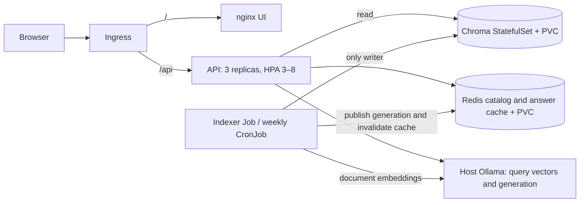

# RAHBAR

[](https://github.com/MuhammadSaimHassan/rahbar/actions/workflows/ci.yml)

RAHBAR answers questions over nine public FAST-NUCES documents using retrieved
passages and validated citations. It declines questions below the relevance floor
and returns a safe fallback when generation cannot satisfy the answer contract.
A separate indexer owns all Chroma writes; API replicas read immutable generations.

The local coding and fixture validation are complete. The badge reports GitHub's
actual state when workflows are published; it is not evidence of a completed hosted
run. Docker Hub setup, protected-branch evidence and hosted CD remain pending.
See [submission status](docs/SUBMISSION.md) for the remaining acceptance work.



## Local preview from VS Code

Use an Ubuntu 24.04 WSL terminal. These commands run the static UI and API with sample
answers; they do not perform corpus retrieval and need no Docker Hub account.
From the existing checkout:

```bash
cd "/mnt/e/course/SEM-5-Course/SCD/Assignment 2/rahbar-starter"
sudo apt update
sudo apt install -y python3-venv python3-pip make
make install VENV="$HOME/.venvs/rahbar"
source "$HOME/.venvs/rahbar/bin/activate"
cd api
SERVE_UI_DIR=../ui RETRIEVER=stub LLM_PROVIDER=stub python -m uvicorn app.main:app --reload --port 8001
```

Open http://localhost:8001 for chat or http://localhost:8001/docs for the API explorer.
The preview environment lives inside Ubuntu for faster package installation; project
files can stay on the Windows E drive. Makefile executable paths are quoted to support
folders containing spaces. For other make targets using this environment, pass
`VENV="$HOME/.venvs/rahbar"` as well.

Keep the terminal running; Ctrl+C stops it. `/readyz` still checks Chroma and Redis,
so a dependency-free preview can serve sample answers while readiness returns 503.

## Full real-corpus deployment from a fresh checkout

The commands below are Bash commands run from the repository root in Ubuntu/WSL.
Prerequisites: Git, Python 3.12 with venv, make, Docker with WSL integration,
minikube, kubectl, and a working host Ollama installation. Allocate at least 6 GiB
and four CPUs for minikube, with additional host memory for Ollama and the OS.
A machine allocating about 3.75 GiB to Docker must increase that allocation first.
The local models and public source downloads require internet access during setup.

Once the completed work has been published to GitHub, obtain a fresh checkout:

```bash
git clone https://github.com/MuhammadSaimHassan/rahbar.git
cd rahbar
make install
make golden-check
make fetch
.venv/bin/python corpus/fetch.py --verify
```

`make fetch` downloads the pinned sources into ignored `corpus/raw/`, verifies their
SHA-256 hashes against [MANIFEST.md](corpus/MANIFEST.md), and writes discovery metadata.
The PDFs and downloaded HTML are not committed. If a public source changes, inspect
it and explicitly review a new manifest rather than bypassing hash verification.

In a separate host Ubuntu terminal, start Ollama listening on the interface reachable
from minikube. If Ollama is already running, configure that service's listen address
instead of starting a competing server:

```bash
OLLAMA_HOST=0.0.0.0:11434 ollama serve
```

In the project terminal, pull both models and build the dedicated cluster and images:

```bash
ollama pull nomic-embed-text
ollama pull llama3.2:3b
make cluster
make images
make corpus-image
kubectl --context=rahbar apply -k k8s/overlays/real-query
kubectl --context=rahbar -n rahbar rollout status statefulset/chroma --timeout=300s
kubectl --context=rahbar -n rahbar rollout status deployment/redis --timeout=300s
```

This is the exact `kubectl apply` order for a fresh real deployment. Kustomize creates
namespace `rahbar`, accounts, configuration, storage, policies and workloads. The real
indexer starts suspended so its host egress can be configured before expensive work.
API readiness is expected to fail until publication. Host Ollama generates both the
768-dimensional `nomic-embed-text` embeddings and `llama3.2:3b` answers. It is outside
Kubernetes; API CPU limits do not constrain its inference memory.

Discover the host address and permit only that address on TCP 11434:

```bash
OLLAMA_HOST_IP="$(minikube -p rahbar ssh 'getent hosts host.minikube.internal' | awk 'NR==1 {print $1}' | tr -d '\r')"
test -n "$OLLAMA_HOST_IP" || { echo "Host address discovery failed"; exit 1; }
for policy in indexer-to-ollama api-to-ollama; do
  kubectl --context=rahbar -n rahbar patch networkpolicy "$policy" --type=json \
    -p="[{\"op\":\"replace\",\"path\":\"/spec/egress/0/to/0/ipBlock/cidr\",\"value\":\"${OLLAMA_HOST_IP}/32\"}]"
done
minikube -p rahbar ssh 'curl --fail --max-time 10 http://host.minikube.internal:11434/api/tags'
kubectl --context=rahbar -n rahbar patch job indexer --type=merge -p '{"spec":{"suspend":false}}'
kubectl --context=rahbar -n rahbar wait --for=condition=complete job/indexer --timeout=7200s
kubectl --context=rahbar -n rahbar logs job/indexer
kubectl --context=rahbar -n rahbar rollout status deployment/api --timeout=300s
kubectl --context=rahbar -n rahbar rollout status deployment/ui --timeout=300s
```

The host curl checks the model endpoint from the node. Firewall rules must also allow
Pod traffic; it does not prove a Pod's NetworkPolicy path. If publication fails, inspect
Job logs, host binding/firewall and the two explicit `/32` policies. Do not widen all
egress to work around a wrong address. Model tags can change upstream; historical
model IDs and the measured inference settings are recorded in PIPELINE.md.

Ollama mode needs no API key. For the optional hosted generator, create its Secret
from an environment variable after namespace creation; never put the value in a file:

```bash
kubectl --context=rahbar -n rahbar create secret generic rahbar-secret \
  --from-literal=LLM_API_KEY="$LLM_API_KEY"
```

Hosted mode additionally needs `LLM_PROVIDER=hosted`, an HTTPS `HOSTED_BASE_URL`, a
compatible strict-schema `LLM_MODEL`, and provider egress configuration. Embeddings
still use Ollama. See [ADR 0004](docs/adr/0004-provider-and-data-governance.md).

On Windows/WSL, keep this running in a separate terminal:

```bash
minikube -p rahbar tunnel
```

Map `127.0.0.1 rahbar.local` in the Windows hosts file and open http://rahbar.local.
Ingress sends `/` to UI and `/api` to API. Test it from the project terminal:

```bash
make ask INGRESS_IP=127.0.0.1 Q="What minimum CGPA avoids academic warning under the June 2026 rules?"
make ask INGRESS_IP=127.0.0.1 Q="What are the current Islamabad shuttle departure times?"
```

The first question has source evidence; the second is the deliberately absent topic.
A local model can still fail answer validation and return a fallback. The historical
CPU run answered only 7 of 18 answerable questions, including one incorrect answer;
valid citations alone do not prove semantic correctness. The current revised prompt
requires a fresh real-model evaluation. No clean-clone deployment of this revised
working tree is claimed yet.

## Re-indexing and operational checks

For a fresh real deployment, do not first apply the dummy overlay. For an existing
stub installation, follow the immutable Job transition in [KUBERNETES.md](docs/KUBERNETES.md).
Reapplying `make apply` selects the stub dev overlay and is inappropriate for real RAG.

The weekly real CronJob is suspended during development. Manually publish a new
same-model generation without redeploying the API:

```bash
kubectl --context=rahbar -n rahbar create job --from=cronjob/reindex "manual-reindex-$(date +%s)"
```

The writer validates its staged collection before switching the Redis catalog and
invalidating the old generation's cache namespace. In-flight readers retain their
snapshot. Old collections need deliberate later cleanup; never use Redis FLUSHDB.
Read [operational demonstrations](docs/OPERATIONS.md) before testing rollout,
rollback or Pod deletion on a dedicated lab cluster.

## API

| Method | Path | Behavior |
| --- | --- | --- |
| POST | `/api/ask` | Question of 3–500 trimmed characters; optional previous question; answer, validated citations, confidence and retrieved evidence |
| GET | `/healthz` | Process liveness without dependency/model calls |
| GET | `/readyz` | Chroma, nonempty matching index, catalog and Redis; 503 with named checks on failure |
| GET | `/metrics` | Prometheus requests, latency, retrieval/generation latency, cache outcomes, abstentions, fallbacks and tokens |

```bash
curl --fail http://localhost:8001/api/ask -H 'Content-Type: application/json' \
  -d '{"question":"What CGPA avoids academic warning?"}'
```

Answers include inline source/section markers; each structured citation must match
retrieved source/section/page. Internal reasoning is removed before the response.
Follow-ups bypass shared answer caching. Retrieved text is untrusted evidence.

## Verification and measured results

```bash
make test
make lint
make golden-check
kubectl kustomize k8s/overlays/prod | kubeconform -strict -summary
python3 scripts/smoke_images.py
python3 scripts/smoke_stack.py
python3 scripts/smoke_indexer.py
python3 scripts/check_submission.py
```

Smoke scripts require built images and Docker. The last checker is a heuristic lint;
review its output alongside source and [submission status](docs/SUBMISSION.md).
The last coding validation passed 87 tests (one integration skip), API coverage 82.80%,
and seven fixture questions through Ingress. The finite operational run passed 135
requests with zero failures and three ready endpoints. These fixture results do not
measure real-model answer quality or Calico enforcement.

The historical real-corpus baseline reports recall@3 77.8%, recall@5 88.9%, validity
of 10 emitted citations 100%, and both required abstentions correct. See
[PIPELINE.md](docs/PIPELINE.md) for the three chunk configurations, cache thresholds,
CPU adapter/cache caveats and manual answer review; [eval/README.md](eval/README.md)
explains the frozen oracle and regression gates.

## Documentation

- [Architecture](docs/ARCHITECTURE.md), [container design](docs/CONTAINERS.md), [Kubernetes runbook](docs/KUBERNETES.md)
- [Corpus selection](docs/CORPUS.md), [pipeline and measurements](docs/PIPELINE.md), [four failure analyses](docs/FAILURE-ANALYSIS.md)
- [Seven engineering answers](docs/ENGINEERING-NOTES.md), [AI attribution](docs/AI-USAGE.md)
- ADRs: [indexer Job](docs/adr/0001-indexer-as-job.md), [publication](docs/adr/0002-versioned-index-publication.md), [Redis cache](docs/adr/0003-semantic-cache-and-follow-ups.md), [provider and governance](docs/adr/0004-provider-and-data-governance.md)
- [CI/CD setup](docs/CI-CD.md), [evidence index](docs/evidence/README.md), [submission checklist](docs/SUBMISSION.md)
